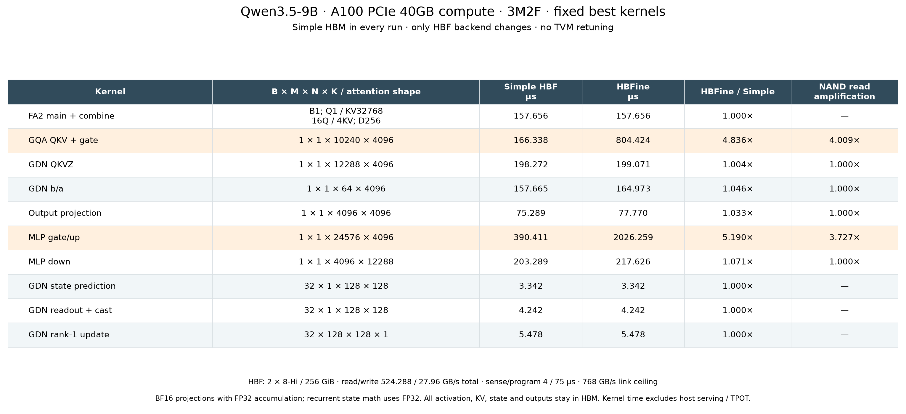

# 固定最优 kernel：Simple HBF 与复杂 HBF 对比

已将 dev-ramulator2 合入 serve-sim。实验固定 A100 PCIe 40GB compute、3M2F、batch=1、32K，
HBM 始终使用原 Simple（naive）模型，仅切换 HBF naive / HBFine bank_plane。
直接重放上轮最优 Tile IR，没有重新搜索或修改 tile、warp、流水线。



| 算子 | B × M × N × K / attention形状 | Simple HBF μs | 复杂 HBF μs | 复杂/简单 | NAND读取放大 |
| --- | --- | ---: | ---: | ---: | ---: |
| FA2 main + combine | B1, Q1, KV32768, 16Q/4KV, D256 | 157.656 | 157.656 | 1.000× | — |
| GQA QKV + gate | 1 × 1 × 10240 × 4096 | 166.338 | 804.424 | 4.836× | 4.009× |
| GDN QKVZ | 1 × 1 × 12288 × 4096 | 198.272 | 199.071 | 1.004× | 1.000× |
| GDN b/a | 1 × 1 × 64 × 4096 | 157.665 | 164.973 | 1.046× | 1.000× |
| Output projection | 1 × 1 × 4096 × 4096 | 75.289 | 77.770 | 1.033× | 1.000× |
| MLP gate/up | 1 × 1 × 24576 × 4096 | 390.411 | 2026.259 | 5.190× | 3.727× |
| MLP down | 1 × 1 × 4096 × 12288 | 203.289 | 217.626 | 1.071× | 1.000× |
| GDN state prediction | 32 × 1 × 128 × 128 | 3.342 | 3.342 | 1.000× | — |
| GDN readout + cast | 32 × 1 × 128 × 128 | 4.242 | 4.242 | 1.000× | — |
| GDN rank-1 update | 32 × 128 × 128 × 1 | 5.478 | 5.478 | 1.000× | — |

这里全部是单算子/指定阶段组的仿真时间，单位 μs，不是整层或 TPOT。
矩阵形状按 B×M×N×K；状态算子 B=32 表示32个value头，服务batch仍为1。
投影为 BF16 输入/输出、FP32 累加；状态计算为FP32，readout包含BF16输出转换。
FA2包含main与combine；内部每个KV头的逻辑QK/PV形状分别为4×32768×256、4×256×32768，
在线分块交错执行，没有把内部MMA拆成独立kernel另测。

## 匹配的硬件参数

| 参数 | 两种后端共同设置 |
| --- | --- |
| GPU | 108 SM，1410MHz，相同资源约束和算术时序 |
| HBM | 3 stacks，24GiB，读/写933/466.5GB/s，读/写270cycles，Simple aggregate |
| HBF | 2 stacks，每stack 8-Hi、256GiB；总512GiB |
| HBF读/写目标 | 每stack 262.144/13.98GB/s；聚合524.288/27.96GB/s |
| HBF sense/program | 4/75μs；Simple为5640/105750cycles |
| HBF外部链路 | 每stack384GB/s，聚合768GB/s，链路延迟10cycles |
| 复杂HBF几何 | 每stack16个Host Channel，每channel16个Bank，每Bank1个Plane、2个4KiB页缓存 |
| 复杂HBF总资源 | 512 Banks / 512 Planes；每Plane512blocks×512pages×4KiB |

8-Hi映射是明确的研究假设。原库只接受16-Hi；本次扩展容量、地址映射、物理die索引与统计数组，
保留16-Hi默认行为。8-Hi的每stack阵列读/program上限为262.144/13.981013GB/s，
与所选host读/写目标一致或略高，未沿用16-Hi的双倍并行度。
所有权重在HBF，激活、KV、状态、临时归约与输出在HBM；HBF输入预置为有效且只读，
不计初始化写入，复杂模型页缓存从冷态开始。两种模型使用相同物理地址段。

复杂模型的4μs是一次4KiB冷页sense时间，缓存命中不再sense；Simple的4μs是请求级固定延迟。
匹配的是几何、目标带宽和物理延迟参数，不能要求两种服务机制产生相同耗时。
写目标与75μs已配置并由独立program测试检查；实际kernel全部HBF写/program/erase为0。

## 两项较大差距的依据

GQA QKV+gate：两边都向HBF读取80MiB权重；复杂模型sense 82,097次，
而单遍只需20,480页，物理读取放大4.009倍，页缓存淘汰81,073次。
其阵列读取量对应约641.4μs的理想下界，实测804.424μs没有突破带宽约束。
MLP gate/up的物理读取放大为3.727倍，耗时2026.259μs。
两个结果均以同一二进制、配置和图再次执行，周期、流量、全部详细计数完全相同。
这些差距反映固定最优布局在Bank页缓存与排队下的表现，没有为复杂模型重新调优。
其余权重投影的物理读取放大为1；FA2与三个状态控制算子没有HBF流量，切换后周期严格相同。

## 配置选择与复现

HBM/HBF选择彼此独立：`hbm.backend: naive | ramulator2`，
`hbf.backend: naive | bank_plane`。naive就是Simple；bank_plane就是HBFine。
Ramulator2通过`-DGTSIM_ENABLE_RAMULATOR2=ON`编译启用，复杂HBF不依赖Ramulator2。
当前Ramulator适配器使用继承的H100 HBM3配置，不能当作A100 HBM2参数使用；本表始终使用Simple HBM。

本次两份完整配置只在HBF backend字段上不同：

- configs/v0.1.0/a100-pcie40-3m2f-grade1-simple-matched.yaml
- configs/v0.1.0/a100-pcie40-3m2f-grade1-hbfine.yaml

```sh
cmake -S . -B build-backends -G Ninja -DCMAKE_BUILD_TYPE=Release \
  -DGTSIM_ENABLE_RAMULATOR2=ON -DHBFINE_BUILD_TESTS=ON
cmake --build build-backends --parallel 4
python3 scripts/experiments/run_serve_hbf_backends.py \
  --out-dir validation/results/serve-hbf-backends/new-run
```

重放入口只用Python标准库，默认覆盖全部10种算子；`--only-state`仅跑三种状态算子。
输入来自上轮搜索保留的candidate Tile IR，逐文件核对SHA256；缺失输入会报错，不触发新搜索。
b/a与三个状态算子从完整GDN赢家图按原有阶段边界提取，保留原始分配与内部依赖，
外部前驱视为已经完成且输入驻留HBM。不是新调度，也没有声称这些阶段在CUDA中是单独launch。
Norm/激活等普通归约与pointwise不计入矩阵乘法表；rank-1更新作为状态矩阵操作另列。

完成20项主仿真及2项离群结果复测，全程1个worker。
29/29项CTest通过（含可选Ramulator2、HBFine、8-Hi参数及原有TVM兼容性回归）；
本轮重放实验本身不调用TVM。六个上轮独立赢家的Simple周期全部保持不变。
全部请求成功drain，HBF流量守恒，输入权重字节数正确；host/array带宽下界检查通过。

[CSV](results/serve-hbf-backends/comparison.csv) ·
[SVG](results/serve-hbf-backends/comparison.svg) ·
[详细结果](results/serve-hbf-backends/results.json) ·
[校验记录](results/serve-hbf-backends/validation.json)

源码快照、配置/图/二进制SHA、原始统计与复测记录均在结果目录。
HBFine依赖提交6215bac；另外保存相对4a1a592的8-Hi补丁与MIT许可证，便于复现本地依赖改动。
源快照包含HBFine的MIT代码及许可证，不含原始NSys trace、模型权重或Ramulator2实现源码。
这些是模型预测，未执行真实GPU CUDA kernel。
