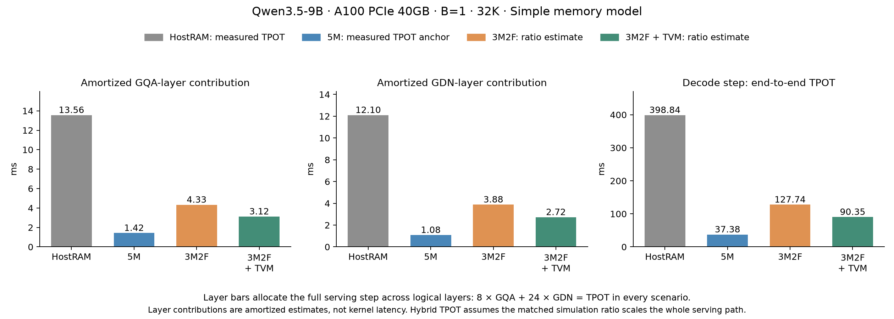

# Qwen3.5-9B：A100 3M2F serving 实验结果

A100 PCIe 40GB，batch=1，32K 上下文，BF16，24 个 GDN 层 + 8 个 GQA 层。
3M2F = 3 HBM + 2 HBF；权重在 HBF，激活、KV cache、卷积/递推状态及输出均在 HBM。
始终使用 Simple 模型。

## 三组、四种场景

| 场景 | GQA 层摊销贡献 ms | GDN 层摊销贡献 ms | TPOT ms/token | 数据性质 |
| --- | ---: | ---: | ---: | --- |
| HostRAM oversubscription | 13.558 | 12.099 | 398.838 | 端到端 TPOT 实测 |
| 5M 全 HBM | 1.424 | 1.083 | 37.376 | 端到端 TPOT 实测锚点 |
| 3M2F | 4.330 | 3.879 | 127.738 | 仿真比例校准估计 |
| 3M2F + TVM | 3.120 | 2.725 | 90.347 | 仿真比例校准估计 |

前两组是分摊完整服务路径开销后的逻辑层贡献，**不是单 kernel 时间或逐层 wall 实测**；
每种场景均满足 `8 × GQA + 24 × GDN = TPOT`。
HostRAM 逐层原始 wall 仍保留在原始审计中，kernel 之间的传输/同步/host 等待没有删除。
全 HBM 实测 TPOT 为 37.376 ms，HostRAM 为 398.838 ms；HostRAM/全 HBM 为 10.67×。
实测来自共享 A100 的单次请求采集，不代表独占硬件多次统计。

TPOT 估计采用同覆盖范围的比值：

`TPOT_3M2F = TPOT_5M实测 × T_3M2F仿真 / T_5M仿真`

仿真覆盖 GQA 的四个大投影 + FA2、GDN 的四个大投影，按 8/24 层加权。
原实现的加权仿真时间为 40.660 ms，全 HBM 为 11.897 ms，TVM 为 28.758 ms。
未显式仿真的辅助算子、LM head 与服务开销按相同比例缩放，是这个估计的假设。
优化后 TPOT 估计降低 29.27%，即 1.41×；相对 HostRAM 的比值为 4.41×。

[优化前九根柱子的图](results/serve-3m2f/comparison-baseline.png) ·
[可缩放 SVG](results/serve-3m2f/comparison-tvm.svg) ·
[可独立展示的 HTML](results/serve-3m2f/presentation.html)

## 单算子结果

| 相同算子范围，μs | 3M2F 原实现 | 3M2F + TVM | 加速 |
| --- | ---: | ---: | ---: |
| FA2 核心 + combine | 173.621 | 157.656 | 1.10× |
| GQA QKV+gate | 170.621 | 166.338 | 1.03× |
| GDN QKVZ | 200.562 | 198.272 | 1.01× |
| 输出投影 | 163.193 | 75.289 | 2.17× |
| MLP gate/up | 391.731 | 390.411 | 1.00× |
| MLP down | 479.221 | 203.289 | 2.36× |

完整 GDN 功能图也完成 16 个候选的搜索：首个可行候选 2273.809 μs，最优 1485.908 μs，
在相同编译路径中快 1.53×。它包含 norm、卷积、状态更新、门控、投影与 MLP，
不和四投影子集混为同一计时范围，也不混入上面的旧基线校准比值。

## 交付与检查

- 主搜索 68/68 个候选完成，7 个最优结果均经过 trace 重放和周期复测。
- 另完成 6 次固定 tile 的预取深度对照；3M2F 为 165.442 / 90.765 / 75.289 μs。
- 本轮单次峰值 7.778 GB，全部仿真串行，1 个 worker。
- FA2 的 HBF 流量为零；投影 HBF 读等于 BF16 权重字节数；全部 HBF 写为零。
- 最优 TensorIR、原生 tuning database、反馈模型、历史、资源与流量日志均已保存。
- 最优仅指已测试候选中的最优；不是 GPU CUDA 实测或全空间最优。

[FA2 最优在线 TensorIR](results/serve-3m2f/tvm/best-ir/fa2/native.tir) ·
[GDN 最优 TensorIR](results/serve-3m2f/tvm/best-ir/gdn_full/scheduled.tir) ·
[全部最优 IR](results/serve-3m2f/tvm/best-ir/) ·
[机器可读结果](results/serve-3m2f/tvm/results.json) ·
[设置、方法与复现](serve-tvm.md) ·
[HostRAM 端到端审计](results/serve-3m2f/wall-time-audit.json)
